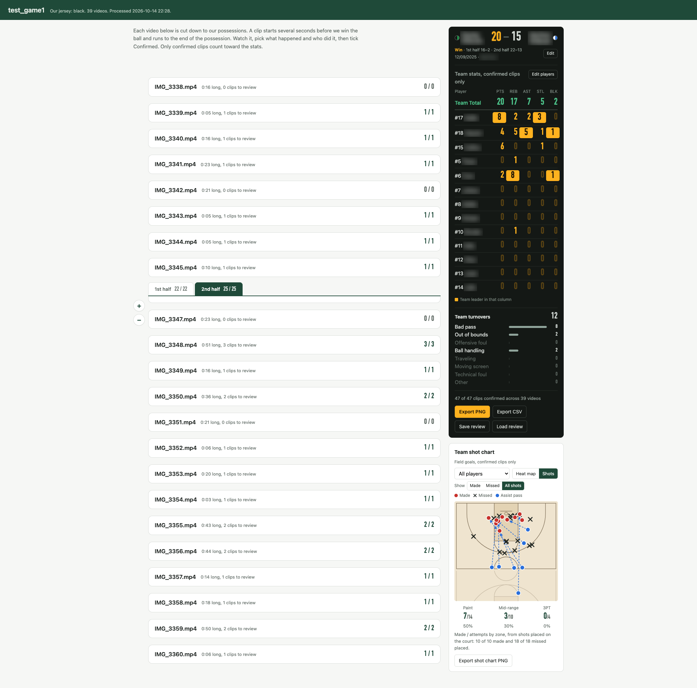

# HoopStats: basketball stats from phone video

> ⚠️ **Warning: vibe-coded with AI.** I built this toy app so I could turn phone videos of my daughter's middle school basketball games into quick stats, without spending every weekend rewinding footage. The whole thing was made by chatting with an AI, so it may well be 100% certified AI slop: confident-looking stats, code that works for reasons nobody fully understands, and the occasional possession handed to the wrong team. Do not use it to settle playground arguments, decide playing time, or explain to a parent why their kid got zero assists. Check the numbers like you'd check the ref. That said, it has already saved me hours of work.

Turn phone videos of a youth basketball game into a box score, shot chart and turnover report for your team. Everything runs on your own Mac: videos never leave your computer.



*The game summary page from a real test game. Player names, team names and the location are blurred.*

## What it does

You film the game on a phone the usual way, following the ball. HoopStats does the tedious part, and you confirm what happened in each short clip.

- **Finds our possessions.** It detects every player, tracks them while the camera pans, and keeps only our team (black or white jersey). Referees, fans and adults on the sideline are filtered out. Because the camera follows the ball, a swing to the half we attack means we have the ball. Each video is cut down to clips of our possessions, starting a few seconds before we win the ball. A fast break still under way when a video ends is kept as a clip too.
- **Works out the attack direction.** Defenders stand between their opponent and the basket, so our team sits closer to the basket we defend. The direction is decided per half, and you can flip it on the page.
- **You confirm each clip** in a summary page:
  - how we got the ball: defensive rebound, steal, block, inbound;
  - the result: made 2 or 3, free throws, missed shot or turnover;
  - who scored, assisted or grabbed the offensive rebound.
- **Box score.** Points, rebounds, assists, steals and blocks per player, plus a Team Total row. Each column's leader is highlighted.
- **Team turnovers by type.** Bad pass, out of bounds, offensive foul, ball handling, traveling, moving screen, technical foul or other.
- **Shot chart.**
  - Click where each made or missed shot was taken, and where the assist pass came from. Long passes from the backcourt are supported.
  - View the result as a heat map of made shots (red) or missed shots (blue), or a hot/cold map of all shots. On that map, color shows make % against the team average and color strength shows the number of attempts.
  - Made and attempted shots, and shooting %, are counted by zone: paint, mid-range and 3PT.
- **Game flow.** A timeline of each half shows when we scored and when we turned the ball over. Shaded columns total each 2, 4 or 5 minutes, and a dashed line shows the running score. The page names the stretch with the most points and the one with the most turnovers. Click a marker to jump to its clip.
  - Times are estimated. Videos in a half are placed in file order. When the phone's recording times are available and agree with that order, the real gaps between videos are kept. Otherwise the videos are laid end to end and stretched over the half. The half length is 20 minutes by default and can be changed on the page.
- **Game info.** Team names, jersey colors (one or two colors per team), date, location, and the score by half.
- **Export.** One PNG with the score, box score, turnovers, game flow and heat map, ready to share with coaches and parents. The CSV has the same tables plus every point and turnover with its estimated game time. The shot chart and the game flow can also be exported as separate PNGs.
- **Minutes (optional).** Clips of the same player are grouped by appearance (OSNet). You name each group and minutes played are computed.

## Install (once)

Python 3.10+ and ffmpeg are required.

```bash
brew install python ffmpeg
cd ~/hoopstats
python3 -m venv .venv && source .venv/bin/activate
pip install --upgrade pip
pip install --only-binary=:all: -r requirements.txt
mkdir -p models
# Person and ball detection (YOLOX, Apache-2.0): the small model is the default, the medium one is used with --accurate
curl -L -o models/yolox_s.onnx https://github.com/Megvii-BaseDetection/YOLOX/releases/download/0.1.1rc0/yolox_s.onnx
curl -L -o models/yolox_m.onnx https://github.com/Megvii-BaseDetection/YOLOX/releases/download/0.1.1rc0/yolox_m.onnx
# Appearance grouping for minutes (OSNet, MIT): only needed without --no-minutes
curl -L -o osnet.zip https://qaihub-public-assets.s3.us-west-2.amazonaws.com/qai-hub-models/models/osnet/releases/v0.62.2/osnet-onnx-float.zip
unzip osnet.zip && mv osnet-onnx-float/osnet.onnx osnet-onnx-float/osnet.data models/
```

## Process a game

1. Make one folder per game, for example `~/hoopstats/games/2026-10-12_vs_Tigers/`.
2. Put the game's videos (.MOV, .mp4, .m4v) in two subfolders, `1st_half/` and `2nd_half/`. `H1`/`H2` or `上半场`/`下半场` also work. Each half's attack direction is then decided on its own. Without subfolders, put the videos directly in the game folder and the switch of sides is detected automatically.
3. Add a `player_info.txt` to the game folder:

```
Jersey: black
7 Emma
11 Mia
23 Zoe
```

The first line is our jersey color (`black` or `white`; `球衣：黑` also works). Then one player per line, number first. You can add, rename, remove or reorder players later on the page.

4. Run:

```bash
cd ~/hoopstats
source .venv/bin/activate
python run_game.py ~/hoopstats/games/2026-10-12_vs_Tigers --no-minutes
```

5. Open `hoopstats_output/summary.html` inside the game folder.

Run the same command again after adding videos: finished videos are skipped. A video that fails is skipped and the error goes to `hoopstats_output/run_log.txt`. Press Ctrl+C once to stop, then run the same command to continue.

Options:

- `--no-minutes` skips appearance grouping and the minutes pages. It is much faster and enough for the box score and shot chart.
- `--accurate` uses the larger YOLOX-M model at 15 fps, about 3x slower. The default is YOLOX-S at 10 fps.
- `--redo` reprocesses everything except detection.

Your review is saved in the browser. Use **Save review** to keep a copy as a file and **Load review** to restore it.

## Pipeline

| Step | File | What it does |
| --- | --- | --- |
| 1 | `detect_video.py`, `frames.py` | YOLOX person/ball detection and camera-motion estimate, cached as `detections.json` |
| 2 | `tracker.py` | Camera-compensated tracking with jersey-color gating |
| 3 | `analyze.py`, `grouping.py` | Team/referee/spectator classification, attack direction, OSNet appearance grouping |
| 4 | `events.py` | Cuts possession clips for both attack directions |
| 5 | `export_review.py`, `review_template.html` | Minutes review page |
| 6 | `run_game.py`, `game_template.html` | Batch run for one game folder and the summary page |

`run.py` still processes a single video. `eval/` holds the evaluation scripts used to tune tracking and grouping.

## Known limits

- The detector is a general model, not trained on basketball. Players are found reliably, but the ball is found in only about 10% of frames. That is why shots, scorers and locations come from you.
- Our jersey numbers are too small to read in wide phone video, so identities come from you.
- Clips rely on the camera following the ball. When a video starts, the camera often lags behind a change of possession, so a very short first segment is skipped.
- Game-flow times are estimates from the video order and lengths, or from the phone's recording times. Without usable recording times, stretches you did not film are left out, so events after a long gap can appear earlier than they happened.
- Each clip records one result, so a miss followed by an offensive rebound and a make is recorded as the make plus the offensive rebound.
- Inference uses the CPU by default. Set `HOOPSTATS_COREML=1` to try Core ML.

## Privacy

Game footage usually shows minors. `.gitignore` keeps game folders, videos, frames, outputs, exported reviews and evaluation labels out of the repository. Only code and the blurred screenshot above are committed.

## Credits

- [YOLOX](https://github.com/Megvii-BaseDetection/YOLOX) by Megvii (Apache-2.0), person and ball detection.
- [OSNet](https://github.com/KaiyangZhou/deep-person-reid) by Kaiyang Zhou et al. (MIT), appearance features, via the [Qualcomm AI Hub](https://aihub.qualcomm.com/) ONNX export.
- [OpenCV](https://opencv.org/), [ONNX Runtime](https://onnxruntime.ai/), NumPy, SciPy and [FFmpeg](https://ffmpeg.org/).

The models are downloaded separately (see Install) and are not part of this repository.
